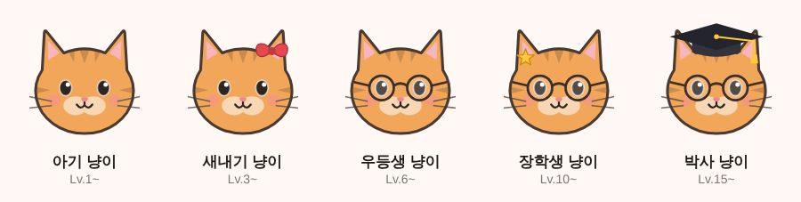
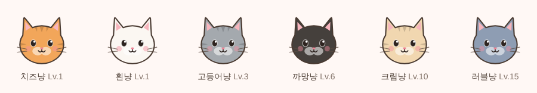

# 클래스 냥이 (ClassCat)

🐾 학교 수업을 들은 시간만큼 고양이가 성장하는 귀여운 공부 기록 앱!

수업을 시작할 때 버튼을 누르고, 끝나면 다시 누르세요. 들은 시간만큼 경험치가 쌓이고, 레벨이 오르면 고양이가 진화해요.



| 🤖 안드로이드 | 🍎 아이폰 |
|:--|:--|
| 네이티브 앱 (`app/`) | 웹앱(PWA) (`web/`) — Safari 에서 **홈 화면에 추가**하면 앱처럼 실행 |

---

## 🍎 아이폰에서 쓰기

1. 아이폰 **Safari** 로 https://lwg5421.github.io/CampusCat/ 접속
2. 아래쪽 **공유 버튼(⬆︎)** → **홈 화면에 추가**
3. 홈 화면의 클래스 냥이 아이콘으로 실행 (전체 화면, 오프라인에서도 열려요)

> 홈 화면 앱과 Safari 탭은 기록이 따로 저장돼요. 먼저 홈 화면에 추가하고 쓰세요.
> 기록은 그 기기에만 저장되고 안드로이드 앱과 동기화되지 않아요. 기기를 바꿀 땐 설정 → **백업 파일로 내보내기 / 가져오기** 를 쓰세요.

웹앱은 안드로이드 앱과 기능이 같지만 **정해진 시간에 울리는 수업 알림은 없어요** (아이폰 웹앱은 서버 없이 예약 알림을 보낼 수 없음).
대신 백업 내보내기·가져오기가 있어요.

---

## 📱 주요 기능

- **수업 시작 / 종료 타이머**
  - 과목 이름을 적고 시작할 수 있어요 (선택)
  - 앱을 꺼도 타이머는 계속 흘러가요 (시작 시각을 저장해 두기 때문)
  - 1분 미만의 수업은 기록하지 않고, 6시간이 넘으면 종료를 깜빡했는지 한 번 더 물어봐요
- **고양이 성장 시스템**
  - 수업 1분 = 1 XP
  - Lv.1 → Lv.2 는 1시간, Lv.2 → Lv.3 은 2시간 … 레벨 L 에서 다음 레벨까지 `60 × L` XP (최대 Lv.30)
  - 경험치는 수업 기록에서 계산하기 때문에 기록을 지우면 경험치도 함께 줄어요
- **진화 시스템**: 아기 냥이 → 새내기 냥이(Lv.3) → 우등생 냥이(Lv.6) → 장학생 냥이(Lv.10) → 박사 냥이(Lv.15)
- **털 색(스킨) 커스터마이징**: 레벨이 오르면 새 털 색이 해금돼요

  

- **수업 기록**: 최근 7일 그래프, 연속 공부 일수, 총 공부 시간, 수업별 기록 (안드로이드는 길게 눌러, 아이폰은 눌러서 삭제)
- **오늘의 목표**: 하루 목표 시간을 정하고 달성률을 확인해요
- **수업 시작 알림** (안드로이드): 매일 정해진 시간에 고양이가 불러 줘요 (재부팅 후에도 유지)
- **백업 내보내기 / 가져오기** (아이폰 웹앱)
- **설정**: 고양이 이름, 하루 목표 시간, 알림 시간, 기록 초기화

---

## 🗂️ 화면 구성

| 탭 | 내용 |
|:--|:--|
| 🏠 홈 | 고양이 인사, 수업 타이머(시작/종료), 오늘 공부 시간과 목표 달성률 |
| 🕘 기록 | 최근 7일 / 연속 공부 / 총 공부 요약, 7일 막대 그래프, 수업 기록 목록 |
| 🐾 고양이 | 레벨·경험치, 진화 단계, 털 색 고르기 (고양이를 눌러 보세요!) |
| ⚙️ 설정 | 이름, 하루 목표, 수업 알림, 데이터 초기화, 버전 |

---

## 🛠️ 사용 기술

- **Android (Java)**, minSdk 24 / targetSdk 34
- **XML 레이아웃** + Material Components (Material 3)
- **Fragment + BottomNavigationView** 로 4개 탭 구성
- **LinearProgressIndicator** 로 XP·목표 진행률 표시
- **RecyclerView (ConcatAdapter + ListAdapter)** 로 기록 목록
- **SharedPreferences** 에 고양이 상태와 수업 기록 저장 (JSON)
- **AlarmManager + BroadcastReceiver** 로 매일 수업 알림
- 고양이 그림은 모두 **벡터 드로어블**: 몸통(털 색으로 tint) · 줄무늬 · 얼굴 · 진화 소품을 겹쳐서 그려요
- 아이폰 웹앱: 빌드 도구 없는 **HTML · CSS · JavaScript(ES 모듈)**, `localStorage` 저장, 서비스 워커로 오프라인 지원, GitHub Pages 배포

## 🧱 코드 구조

```
app/src/main/java/com/example/campuscat/
├── MainActivity.java          하단 탭 + 툴바
├── domain/                    안드로이드에 의존하지 않는 순수 로직 (단위 테스트 대상)
│   ├── LevelSystem.java       XP ↔ 레벨 계산
│   ├── CatStage.java          진화 단계
│   ├── CatSkin.java           털 색과 해금 레벨
│   ├── StudySession.java      수업 한 번의 기록
│   ├── StudyStats.java        날짜별 합계, 연속 공부 일수 등 통계
│   ├── ReminderTime.java      다음 알림 시각 계산
│   └── TimeFormatter.java     "1시간 30분", "01:23:45" 같은 표시용 문자열
├── data/CatRepository.java    SharedPreferences 저장소
├── ui/                        화면 (Home / Records / Cat / Settings) 과 CatView, WeekBarChartView
└── reminder/                  알림 예약, 알림 표시, 재부팅 후 재예약

web/                           아이폰용 웹앱 (PWA)
├── index.html, css/app.css    화면과 스타일 (안드로이드와 같은 색, 라이트/다크 모드)
├── js/domain.js               레벨·진화·스킨·통계 규칙 (안드로이드 domain 패키지와 같은 규칙)
├── js/storage.js              localStorage 저장소 (CatRepository 와 같은 규칙) + 백업
├── js/cat-art.js, js/cat.js   안드로이드 벡터와 같은 도형의 고양이 SVG
├── js/app.js                  화면 동작
├── sw.js, manifest.webmanifest  오프라인 캐시, 홈 화면 앱 설정
└── test/                      Node 단위 테스트
```

> 레벨·진화 규칙이나 고양이 그림을 바꿀 때는 안드로이드(`domain/`, `res/drawable/cat_*.xml`)와 웹(`web/js/domain.js`, `web/js/cat-art.js`)을 같이 바꿔 주세요.

## ▶️ 빌드 & 테스트

```bash
./gradlew assembleDebug        # 디버그 APK → app/build/outputs/apk/debug/
./gradlew testDebugUnitTest    # 레벨·통계·시간 계산 단위 테스트
```

```bash
cd web
npm test                       # 웹앱 단위 테스트 (Node 20+, 설치할 패키지 없음)
python3 -m http.server 8000    # http://localhost:8000 에서 미리 보기
```

GitHub Actions 가 푸시할 때마다 돌아가요.

- `android.yml`: 빌드, 단위 테스트, lint, 디버그 APK 아티팩트 업로드
- `web.yml`: 웹앱 단위 테스트, `main` 에 반영되면 GitHub Pages 로 배포
  - 처음 한 번은 저장소 **Settings → Pages → Build and deployment → Source** 를 **GitHub Actions** 로 바꿔야 해요.

---

## ⚡ 향후 추가 예정

- 시간표 등록 (요일·교시별 수업 자동 알림)
- 고양이 소품 상점 (모은 XP로 아이템 구매)
- 홈 화면 위젯

---

## 👤 개발자

- **개발자 이름** : 타이머스
- **GitHub** : https://github.com/lwg5421
